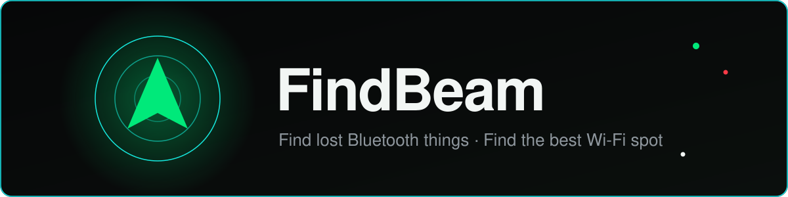

<p align="center">
  
</p>

<h1 align="center">FindBeam</h1>

<p align="center">
  <strong>Find lost Bluetooth things with a live compass arrow. Find the strongest Wi-Fi spot in your home.</strong>
</p>

<p align="center">
  <a href="https://github.com/Shishir-ip/FindBeam/releases"></a>
  <a href="LICENSE"></a>
  
  
</p>

---

## What is FindBeam?

FindBeam helps you answer two everyday questions:

1. **Where are my earbuds / watch / tracker?** — FindBeam turns your phone into a
   signal-seeking compass: scan for nearby Bluetooth devices, do one slow
   full-circle turn, and a big glowing arrow points you to the lost object —
   with radar beeps that speed up as you get closer.
2. **Where in my home is the Wi-Fi strongest?** — Walk around with a live
   Geiger-style meter, see your best spot so far, and save named spots with a
   quick latency + speed test to compare rooms side by side.

**Works fully offline. No account, no ads, no data collection — ever.**

## Features

### 🎯 Object Finder
- Live BLE scanning with signal-strength meters, history sparklines and
  device-type detection — names are resolved from Android's device cache and
  `BluetoothClass`, so real names appear even when ads omit them
- **Direction scan** — hold the phone flat, turn a full circle; FindBeam keeps
  the entire spin in an anchor estimator (no time window) and finds the
  strongest direction with weighted circular statistics on the strongest
  cluster, falling back to the weighted mean of all samples on noisy channels
- **Guidance mode** — a big glow arrow that always points at the object as you
  turn and walk, with a 15 s sliding-window estimator continuously re-checking
  the direction while you move
- Smoothed signal math so the arrow and meter don't jump around
- **"Getting warmer / colder"** feedback, approximate distance (median-filtered)
  and step counter
- **Very-close mode** — beeps and vibration accelerate as you approach, and the
  app declares *"You're right next to it"* when the signal peaks and stops improving
- Signal-lost banner if the object stops advertising while guiding
- Rename unknown devices to keep them friendly, filter by category and search

### 📶 Wi-Fi Best Spot
- Big animated meter with **live RSSI from the modern ConnectivityManager
  NetworkCallback** (Android 10+), legacy polling as fallback — no more stale
  readings from the deprecated `WifiManager.connectionInfo`
- Geiger-style tone that rises in pitch as the signal improves
- **Best spot so far** tracking with a pulse when you break your record
- **Save this spot** (press & hold) — records signal strength plus a quick
  latency and download test, then names the place ("Bedroom corner")
- Ranked list of saved spots from best to worst — decide where your desk or
  router should live
- Nearby networks list with band (2.4 / 5 / 6 GHz) and channel info

### ✨ The details
- Black & white premium look with neon-green / red direction accents
- Light, dark and auto themes, tuned for both
- Figure-8 **compass calibration** prompt when accuracy drops
- Clear permission explanations — Bluetooth, Location and Motion — with honest
  reasons for each
- **Check for updates** straight from the app (reads GitHub Releases)
- Sounds & haptics toggles, keep-screen-awake while searching
- Android 8.0+ (API 26), built with Jetpack Compose

## Download

Grab the latest signed APK from the
[**Releases**](https://github.com/Shishir-ip/FindBeam/releases) page and
install it on your phone. Android will ask you to allow installs from this
source — that's normal for apps outside the Play Store.

## Build from source

```bash
git clone https://github.com/Shishir-ip/FindBeam.git
cd FindBeam
./gradlew :app:assembleDebug      # debug APK
./gradlew :app:assembleRelease    # release (needs keystore.properties)
```

The output APK lands in `app/build/outputs/apk/`.

**Signing:** release builds read `keystore.properties` at the project root
(gitignored) with:

```properties
storeFile=findbeam-release.keystore
storePassword=...
keyAlias=findbeam
keyPassword=...
```

Generate a keystore with:

```bash
keytool -genkeypair -v -keystore findbeam-release.keystore \
  -alias findbeam -keyalg RSA -keysize 2048 -validity 10000
```

## Permissions, explained

| Permission | Why it's needed |
|---|---|
| **Bluetooth** (scan / connect) | Discover nearby devices and measure their signal |
| **Location** | Android requires it for Bluetooth & Wi-Fi scanning. FindBeam never derives or stores your position |
| **Motion & activity** | The optional step counter shown while searching |
| **Vibration / Wi-Fi state** | Haptic feedback; reading and triggering Wi-Fi scans |
| **Internet** | Only for the *manual* "Check for updates" action and the user-initiated speed test. All core features work offline |

## Privacy

- No account. No ads. No analytics. No trackers.
- Device names, saved spots and settings live only on your phone.
- The network test pings public endpoints **only when you ask for it**.

## Tech stack

Kotlin · Jetpack Compose (Material 3) · Navigation Compose · BLE scanning API ·
Rotation-vector sensor · AudioTrack tone synthesis · Vibration effects ·
R8-minified release builds · GitHub Actions CI

## License

[MIT](LICENSE)
